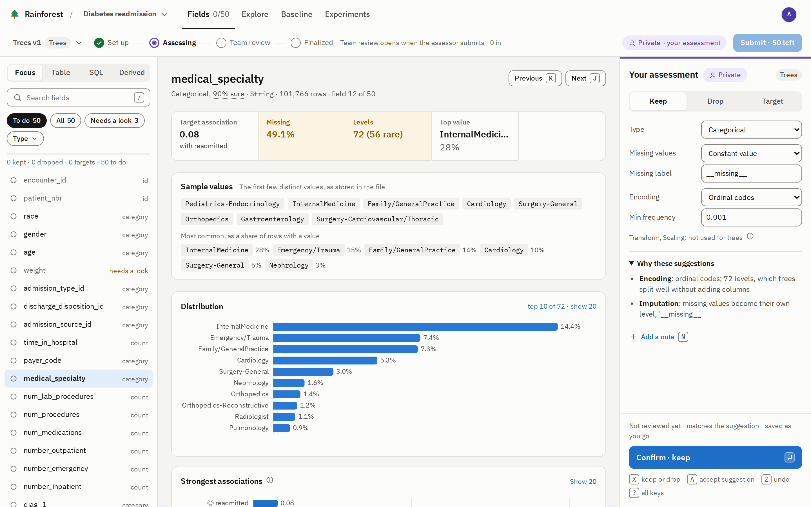
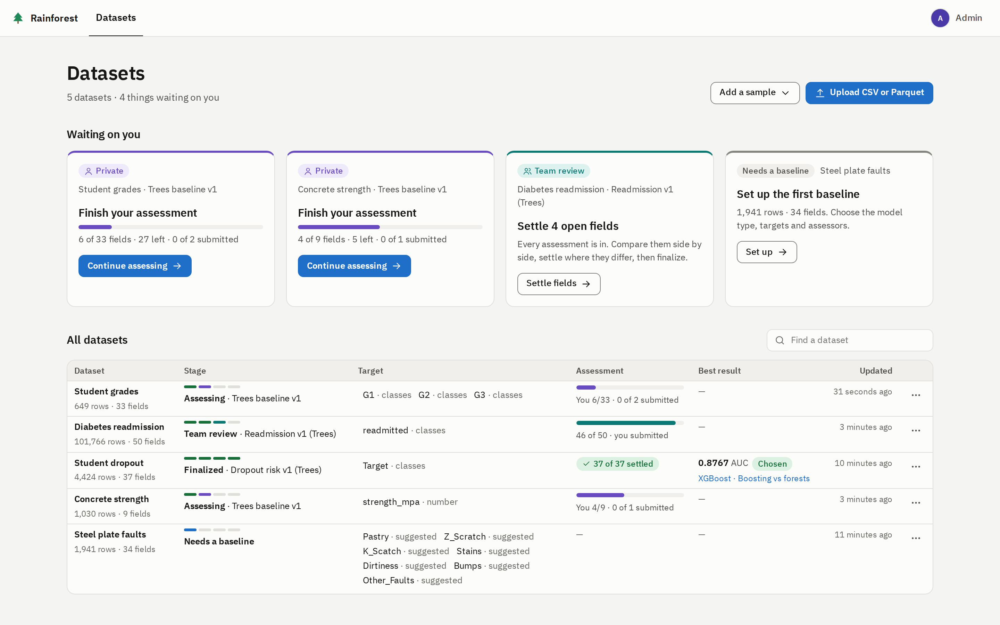
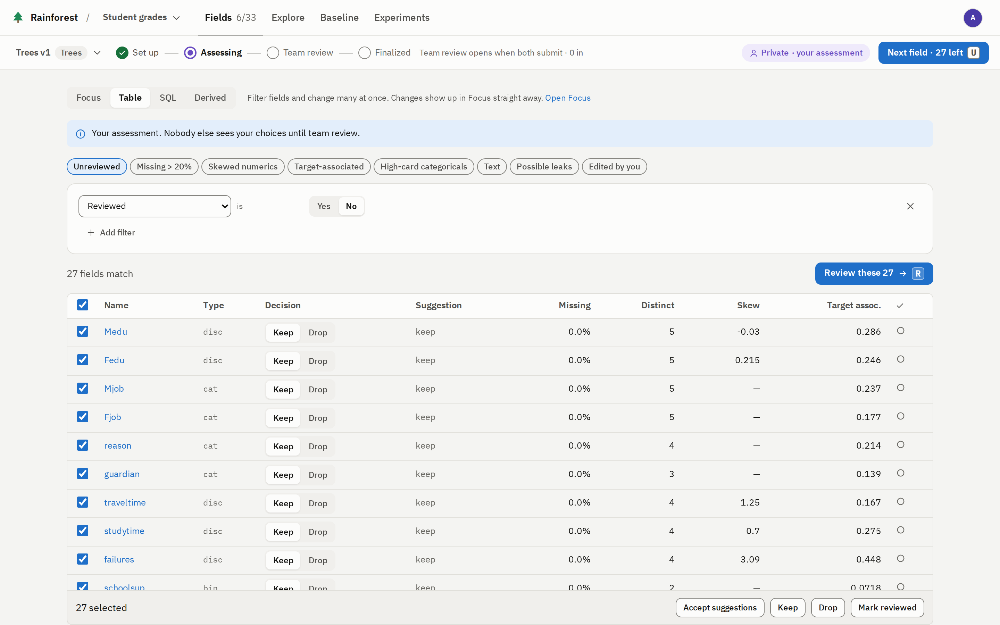
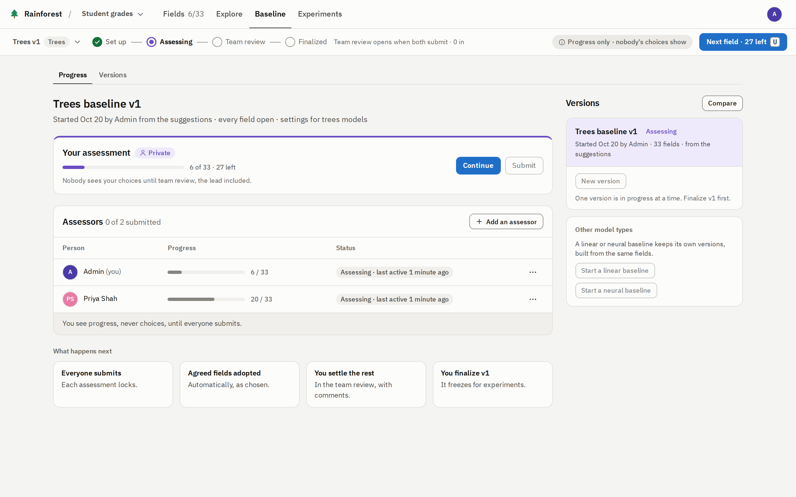
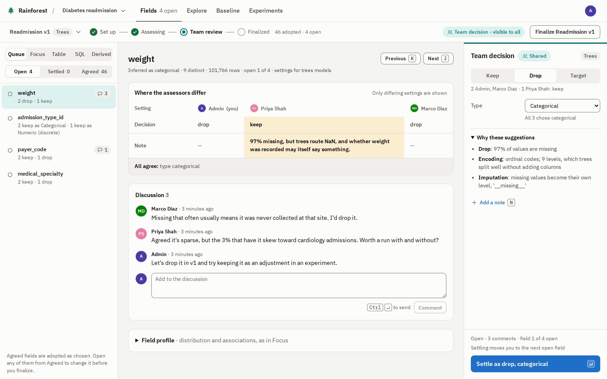
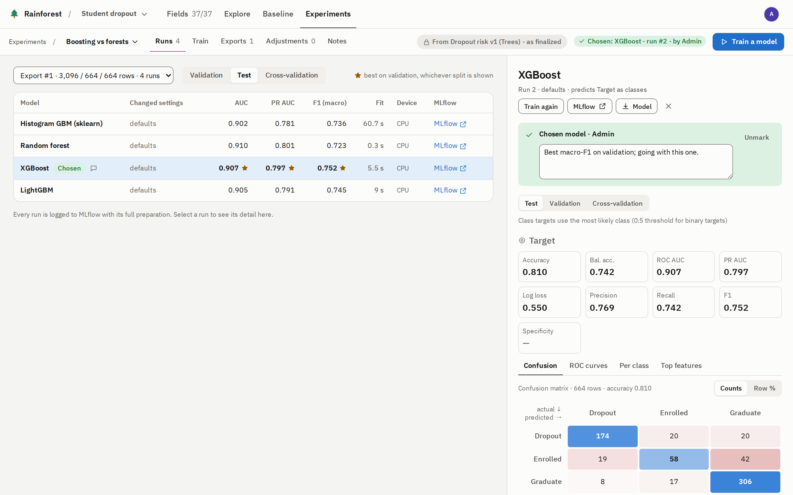
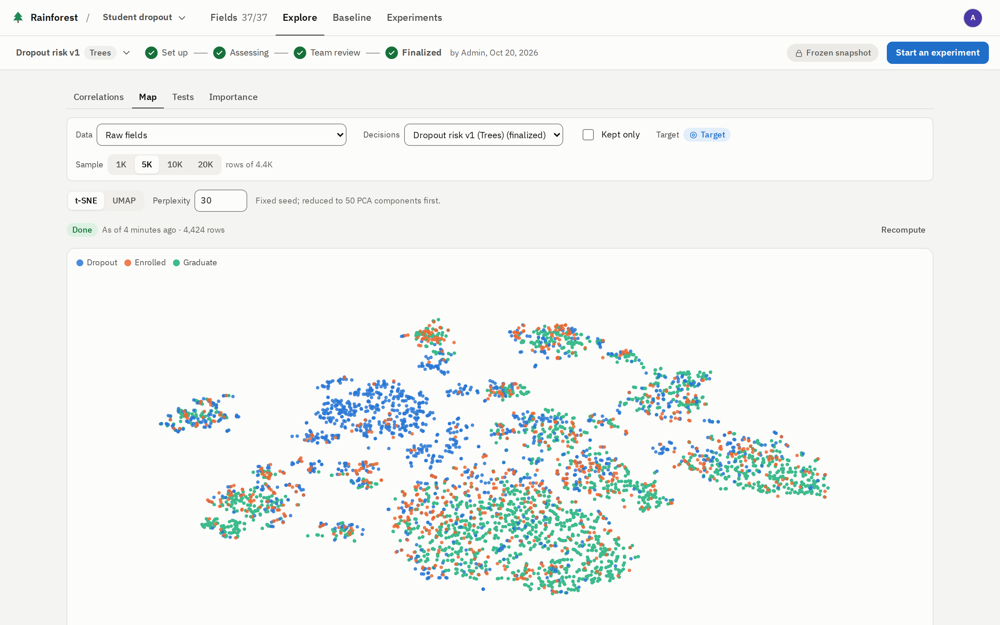

# 🌲 Rainforest

Rainforest is a self-hosted web app for preparing wide, mixed-type tabular data for machine learning, on your own or as
a team. Upload a CSV or Parquet file, and Rainforest profiles every column and suggests how to prepare it, with the
evidence for each suggestion. You review the fields, agree on the decisions and freeze them as a versioned **baseline**.
Rainforest then builds model-ready Parquet from the baseline, trains models on it, and logs every run to MLflow.



## Why use it

Much of a tabular model's quality is decided while its data is prepared: which columns to keep, what a missing value
means, how to encode a code. Those choices usually live in one person's notebook. When someone else picks the data
up, or the model is retrained a year later, nobody can say exactly how the data was prepared, or why.

Rainforest makes data preparation reviewed, recorded and repeatable:

- **Every field gets looked at.** Each column gets a profile, its distribution, its strongest associations and a
  suggested decision, so the 150th field of a wide file gets the same care as the first.
- **Suggestions explain themselves.** Each one names its evidence, such as *97% of values are missing*. Fields that
  could leak the target are flagged before they reach a model.
- **Agreement is part of the process.** Several people assess the same fields without seeing each other's choices, so
  nobody anchors on the first opinion. What they agree on is adopted, and only the disagreements need a discussion.
- **A baseline exports the same way every time.** A finalized baseline is frozen. Every export and model run records
  the baseline it came from, and every change to the team's decisions is logged with who made it.
- **Preparation matches the model.** *Trees* baselines never scale or log-transform, and leave missing values for the
  model to route. *Linear* and *Neural* baselines get their own defaults.
- **Exports are leakage-safe.** The rows are split first. The preprocessing is fitted on the training rows only, then
  applied to every row.
- **Training is in the same place.** Train and compare models on an export without writing code, and open any run in
  MLflow. You can also download the export, its fitted preprocessor and the trained models for your own code.
- **It runs on your own hardware.** Docker Compose runs the app, Postgres and MLflow on a machine you control, and
  your data stays there.

Rainforest is built for data science teams who need to agree on, and record, how a dataset is prepared. It works solo
too: you are the lead and the only assessor, and you still get the suggestions, the leak checks, the frozen baselines
and the tracked runs.

## How it works

```
Upload → Assess → Team review → Finalize baseline → Experiment → Export → Train
```

The screenshots below use the real datasets that ship with Rainforest.

### 1. Upload

Upload a CSV or Parquet file, or add one of the sample datasets. Rainforest loads it into Postgres, profiles every
column and suggests a decision for each field. The *Datasets* page shows where each dataset stands and what is waiting
on you. A team whose data is in MongoDB can instead create a dataset from its collections with *Connect ▾* and pull
again later (see [Connected datasets](docs/data-preparation.md#connected-datasets)).



### 2. Assess

A lead sets up the dataset's baseline: its model type, targets and assessors. Each assessor then works through the
fields on their own, keeping, dropping or retyping each one and checking its settings. *Fields · Focus*, at the top of
this page, walks the fields one at a time with keyboard shortcuts. *Fields · Table* filters the fields and changes many
at once.



An assessment is private until everyone has submitted. The lead sees each assessor's progress, never their choices.



### 3. Team review

When the last assessor submits, the fields everyone agreed on are adopted. The rest form a review queue, with every
assessor's choice and notes side by side and a discussion. A lead settles each field, then finalizes.



### 4. Finalize, experiment and train

Finalizing freezes the decisions as a numbered baseline version, such as *Trees v1*. A lead changes it later by starting
a new version. Anyone but a Viewer can start an experiment from the baseline, and adjust the experiment's copy without
touching the baseline. An export splits the rows, fits the preprocessing on the training rows and writes Parquet. You
train a chain of models on it, one per target, and compare the runs with their metrics, charts and MLflow links.



### Explore at any point

*Explore* shows a dataset's correlations, a 2-D map of its rows coloured by the target, a test of each field against
the target, and feature importance. *Fields · SQL* is a read-only SQL console over the data and the decisions.



## What's included

- **Type inference** for every column: numeric, categorical, binary, text, date, identifier or constant, with a
  confidence and the reasons.
- **Several targets at once.** Each target is predicted as classes, a number or bands, and each model in the chain
  also learns from the predictions for the targets before it.
- **Models:** LightGBM, XGBoost (CPU or NVIDIA GPU), scikit-learn's histogram GBM and random forest, logistic and ridge
  regression, and an MLP, with cross-validation and parameter sweeps.
- **Derived fields** computed from a dataset's own fields, such as a ratio or a grouping of codes.
- **Sign-in** by picking a profile, or with OIDC for teams, and three roles: *Team Lead*, *Team Member* and *Viewer*.

## Quick start

You need Docker with Compose v2, `make`, at least 6 GB of free RAM, and disk space of about 2–3× the files you upload.
See [Sizing](docs/deployment.md#sizing).

```bash
git clone https://github.com/LikelyCause/rainforest.git && cd rainforest
cp .env.example .env    # then set POSTGRES_PASSWORD and READONLY_PASSWORD
make up                 # builds and starts everything; the first build takes a few minutes
```

> [!IMPORTANT]
> Set `POSTGRES_PASSWORD` before the first `make up`. Postgres reads it only when it creates its data volume, so
> changing it later has no effect.

Open `http://localhost:8080` (or the Docker host's address; `UI_PORT` sets the port) and pick the *Admin* profile.
MLflow is at `/mlflow/`; `MLFLOW_BROWSE_URL` points every MLflow link at another address instead.

> [!WARNING]
> The default sign-in mode doesn't authenticate: anyone who reaches the page can pick any profile, a lead's included.
> Use it alone or on a trusted network. Teams should use OIDC; see [Sign-in](docs/deployment.md#sign-in).

## Try it

This uses the *Concrete strength* sample, which predicts a concrete's strength from its mix, with you as the only
assessor.

1. On *Datasets*, choose *Add a sample ▾ → Real datasets* and add *Concrete strength*. Open it when it's ready.
2. At *Set up the first baseline*, keep the defaults (*Trees*, the suggestions, the target `strength_mpa`, and you as
   the only assessor) and choose *Start Trees baseline v1*.
3. In *Fields*, step through the fields and read *Why these suggestions*. Press `A` to accept a suggestion and move
   on.
4. Choose *Submit assessment* at the top right, then *Finalize Trees v1*. With one assessor there is nothing to settle.
5. Choose *New experiment from v1*, name it, and choose *Export for trees models*.
6. On *Train*, choose *Train* (LightGBM is the default). The run appears on *Runs*, with a link to it in MLflow.

The empty *Datasets* page also offers a generated *50k × 150 demo*, and you can upload your own CSV or Parquet file.

## Deploying

| Setup | Use when | How |
|---|---|---|
| Solo / demo | One person, or a trusted network | `make up` with the defaults |
| Team with OIDC | Several people, real sign-in | `RAINFOREST_AUTH_MODE=oidc` and your provider's settings in `.env`; see the [checklist](docs/deployment.md#team-deployment-checklist) |
| Reference Keycloak | Trying OIDC (development only) | `make up-keycloak`; see [Reference Keycloak](docs/deployment.md#reference-keycloak-development-only) |
| GPU | XGBoost on an NVIDIA GPU | `make up-gpu`; see [GPU](docs/deployment.md#gpu) |
| Kubernetes | One release per team on a cluster, with Postgres and MLflow in the release or external | the Helm chart in `deploy/chart/rainforest`; see [deploy/README.md](deploy/README.md) |

On Compose everything is configured in `.env`; on Kubernetes, in the chart's values. [Configuration](docs/configuration.md) lists every setting. The stack runs four
containers:

| Service | What it does |
|---|---|
| `ui` | nginx serving the React app; proxies `/api/` to the API and `/mlflow/` to MLflow |
| `api` | FastAPI: profiling, exports and training jobs; keeps files on the `appdata` volume |
| `db` | Postgres 16: app metadata (`meta.*`), each dataset's rows (`raw.ds_<id>`), and MLflow's runs |
| `mlflow` | MLflow tracking server, with model artifacts on the `mlartifacts` volume |

Useful commands:

| Command | Purpose |
|---|---|
| `make up` / `make down` | Start everything / stop it, keeping the data |
| `make logs` | Follow the API's logs |
| `make train EXPORT=<id>` | Train on an export from the command line (`MODEL=`, `DEVICE=` optional) |
| `make psql` | Open psql as the database owner |
| `make test-db` | Run the API tests against a throwaway Postgres |
| `make lint` / `make format` | Lint, or format, the API and the UI |
| `make clean` | Stop everything and **delete all data volumes** |

The [Makefile](Makefile) has the rest.

## Documentation

- **Using it:** [Concepts](docs/concepts.md) · [User guide](docs/user-guide.md) ·
  [Team workflow](docs/team-workflow.md) · [Data preparation](docs/data-preparation.md) · [Explore](docs/explore.md) ·
  [Experiments and training](docs/experiments-and-training.md) · [MLflow](docs/mlflow.md) · [SQL](docs/sql.md)
- **Running it:** [Deployment](docs/deployment.md) · [Kubernetes](deploy/README.md) · [Configuration](docs/configuration.md) ·
  [Security](docs/security.md)
- **Developing it:** [Development](docs/development.md) · [Architecture](docs/architecture.md) · [API](docs/api.md)

## License

Rainforest is released under the [MIT License](LICENSE).

The five sample datasets under *Add a sample ▾ → Real datasets* come from the
[UCI Machine Learning Repository](https://archive.ics.uci.edu/) and are used under
[CC BY 4.0](https://creativecommons.org/licenses/by/4.0/):

| Dataset | Rows × columns | Targets | Source |
|---|---|---|---|
| Diabetes readmission | 101,766 × 50 | `readmitted` (3 classes) | Clore, Cios, DeShazo & Strack (2014), [doi:10.24432/C5230J](https://doi.org/10.24432/C5230J) |
| Student grades | 649 × 33 | `G1`, `G2`, `G3` (grades 0–20) | Cortez (2008), [doi:10.24432/C5TG7T](https://doi.org/10.24432/C5TG7T) |
| Student dropout | 4,424 × 37 | `Target` (dropout, enrolled, graduate) | Realinho, Vieira Martins, Machado & Baptista (2021), [doi:10.24432/C5MC89](https://doi.org/10.24432/C5MC89) |
| Steel plate faults | 1,941 × 34 | seven yes/no fault types | Buscema, Terzi & Tastle (2010), [doi:10.24432/C5J88N](https://doi.org/10.24432/C5J88N) |
| Concrete strength | 1,030 × 9 | `strength_mpa` (a number) | Yeh (1998), [doi:10.24432/C5PK67](https://doi.org/10.24432/C5PK67) |
